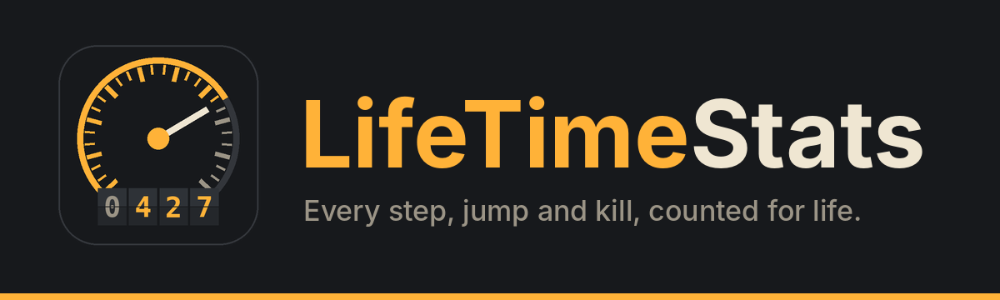

# LifeTimeStats

Lifetime statistics for your character in **World of Warcraft: Forever**. Install it once and it keeps counting for as long as you play: steps taken, times jumped, unique NPCs met, dungeon and raid bosses killed, fastest times, longest corpse runs, biggest falls survived, every dodge and parry, and hundreds more. Some of it is useful. A lot of it is gloriously useless.

- **Author:** Malikor
- **Client:** WoW: Forever (interface 16001, build 1.60.1)
- **License:** GPL-3.0-or-later (see `LICENSE`)
- **Tracks:** 616 statistics, top lists, fastest times, uniques and firsts, plus a **dungeon book** for all 35 Forever dungeons and 3 raids (bosses found, full clears, fastest clear, runs under or over level), an **Adventurer score**, play-session history with CSV export, peak character stats and battleground scoreboards

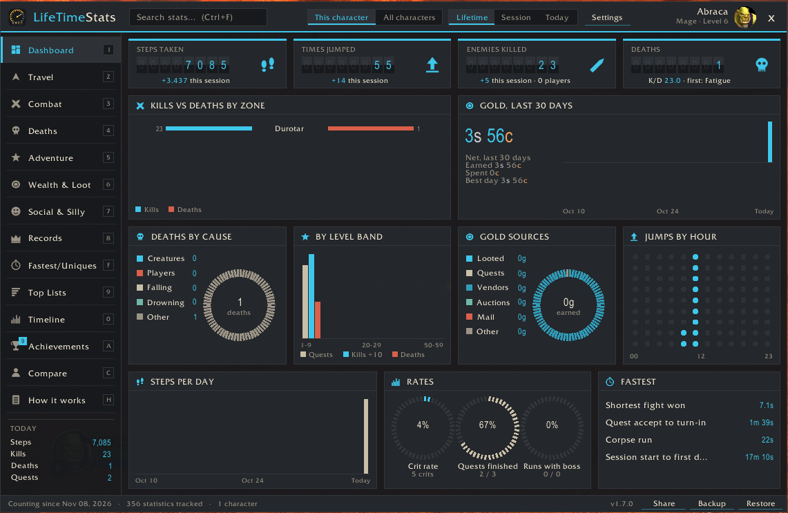

<details>
<summary><b>More screenshots</b></summary>

| | |
|---|---|
| 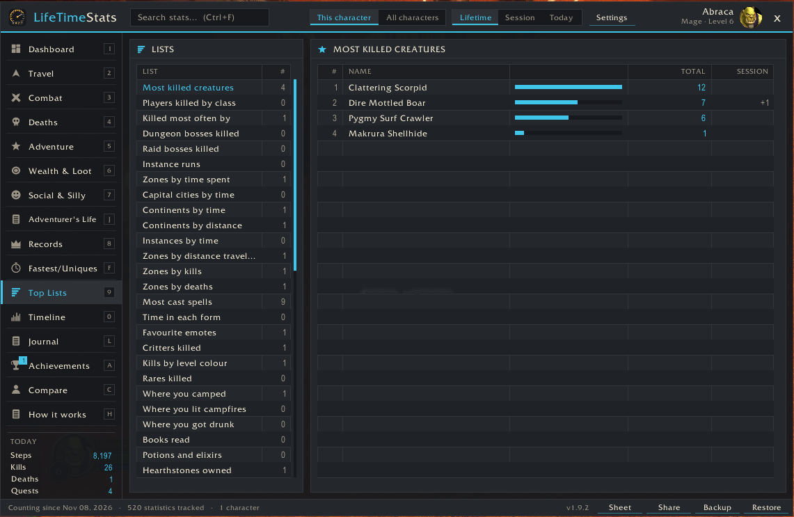 Top Lists | 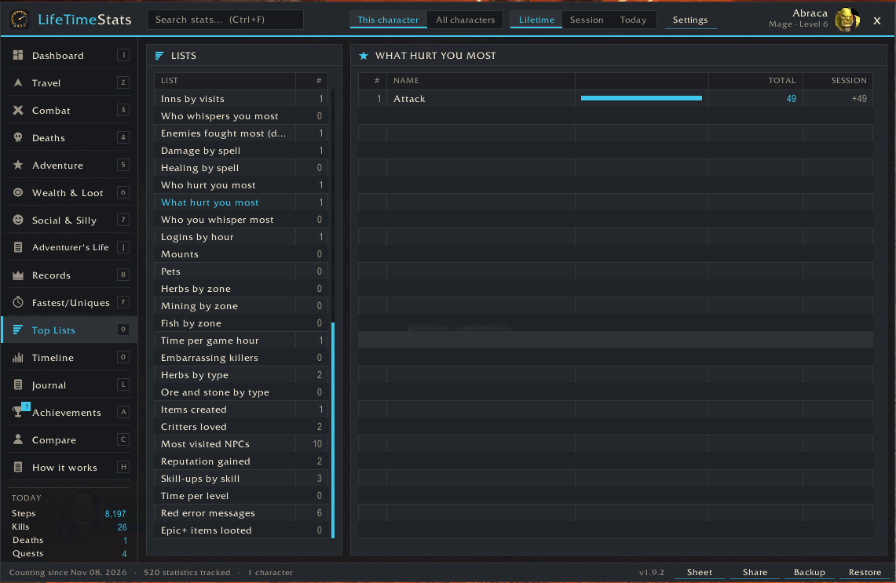 What hurt you most (damage meter) |
| 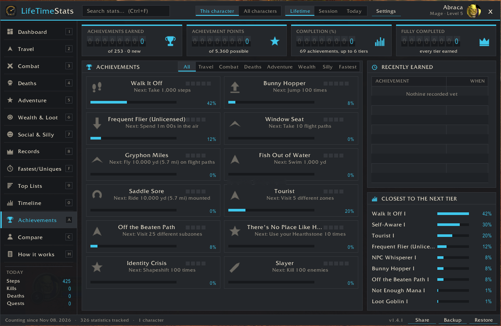 Achievements | 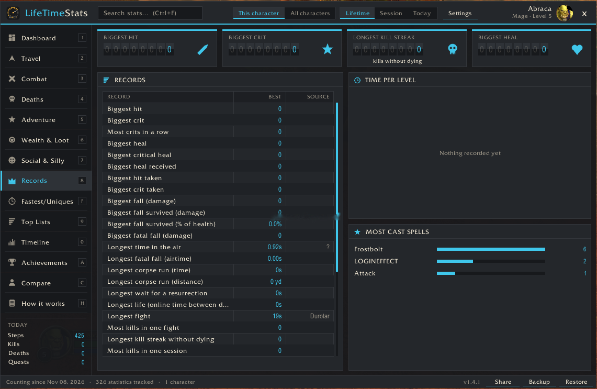 Records |
| 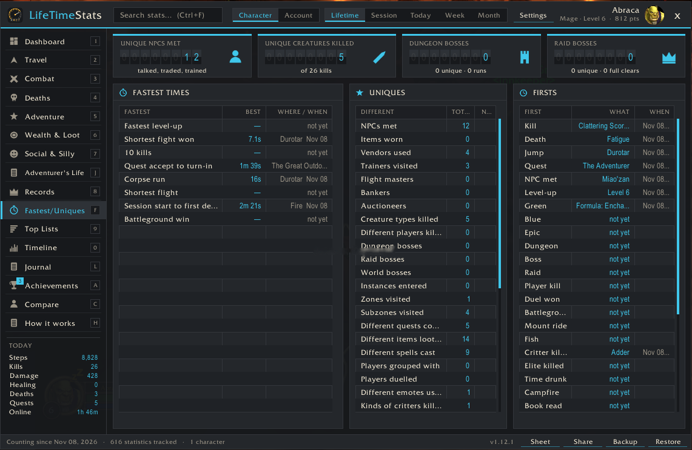 Fastest & Uniques | 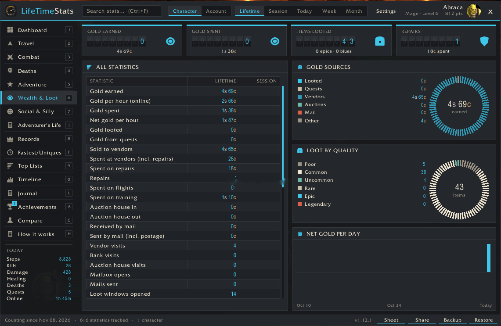 Wealth & Loot |
| 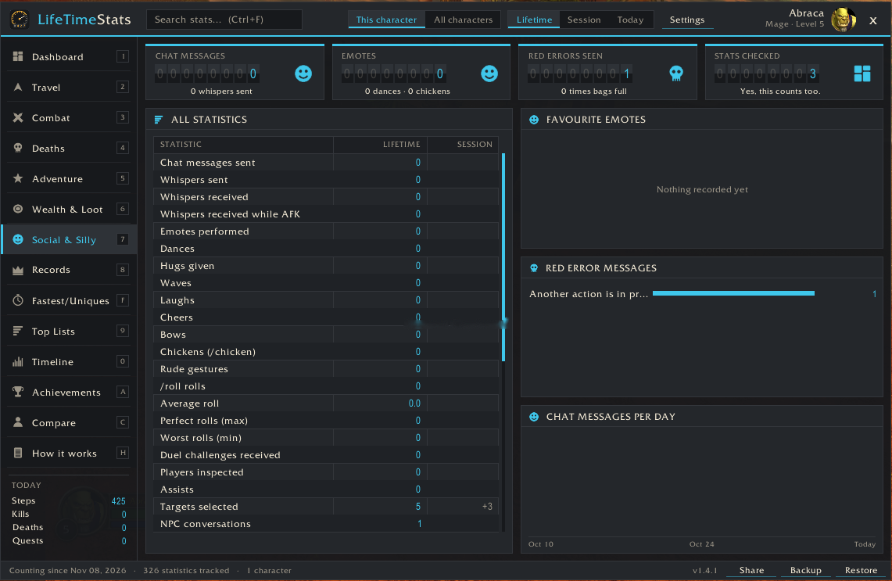 Social & Silly | 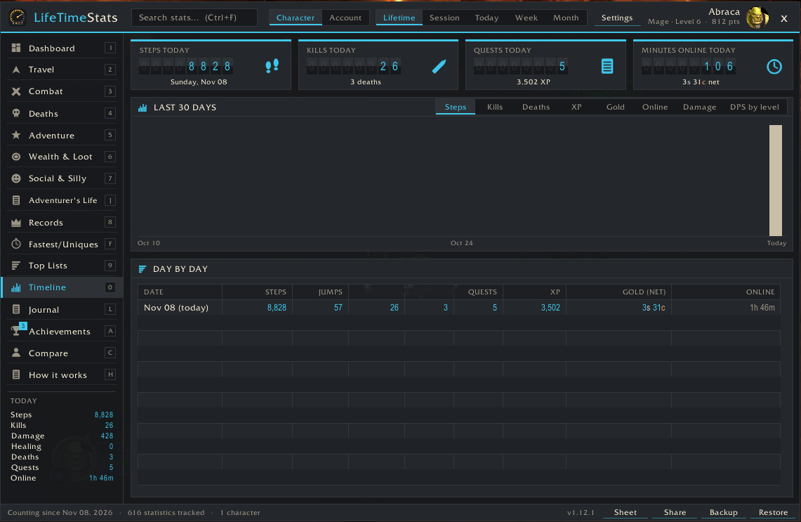 Timeline |
| 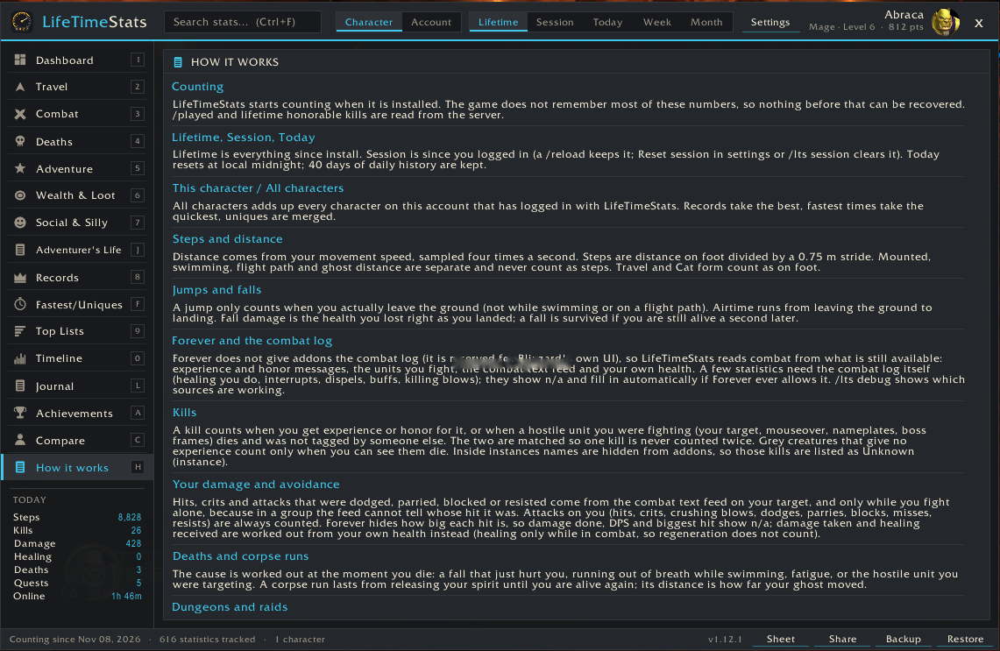 How it works | |

The dashboard is from 1.10; the other captures are from versions 1.7 to 1.9 (Mage, level 5–6, class-colour accent). Later versions add the Legend card, Week/Month ranges, themes and the dungeon book.
</details>

## Download
Get the latest `LifeTimeStats-vX.Y.Z-forever.zip` from the [Releases](../../releases) page and unzip it into `World of Warcraft\_classic_beta_\Interface\AddOns\`.

## The window

A dashboard-style window (`/lts`): charcoal panels, odometer digit counters and tick-ring charts. The accent colour follows your **class colour** (switch back to the theme colour in settings).

**Themes** (Settings → Theme, applies after /reload): **Auto** (default: matches the UI addon you run), **Odometer** (LifeTimeStats' own look), **Blizzard** (gold on black, Friz Quadrata), **ElvUI**, **Tukui** and **EllesmereUI**. With ElvUI, Tukui or EllesmereUI loaded, their live colours and font are used (EllesmereUI through its official skinning API).

- **Header:** search box (Ctrl+F, also finds entries in the Top Lists, e.g. a spell or creature), Character / Account, Lifetime / Session / Today / Week / Month, settings, your portrait. In Account + Lifetime, hover a value to see each character's part.
- **Sidebar pages:** Dashboard, Travel, Combat, Deaths, Adventure, Wealth & Loot, Social & Silly, Records, Fastest & Uniques, Top Lists, Timeline, Adventurer's Life, Journal, Achievements, Compare, How it works. Keys 1–9, 0, F, A, C and H jump between pages while the mouse is over the window (never in combat, never while typing).
- **Every page** opens with four odometer counters, then a gridded table of every statistic on that page and charts beside it.
- Hover any row, counter or chart bar for exactly how it is measured and where a record came from.
- Ctrl + mouse wheel on the header changes the window scale. The default scale fits your screen height.

### Dashboard
Steps, jumps, kills and deaths counters · kills vs deaths in your five deadliest zones · net gold per day for 30 days · deaths by cause · quests/kills/deaths per level band · where your gold came from · jumps by hour of day · steps per day · crit rate, quest completion and dungeon runs with a boss kill · **Your legend**: signature spell, nemesis, most hunted creature, best fight and homeland.

## What it counts (highlights)

| Page | Examples |
|---|---|
| Travel | Total distance; on foot, mounted, **swimming**, **flight paths** and as a ghost; steps; jumps; time in the air; flights; Hearthstone uses; mount-ups; shapeshifts; sits; auto-run toggles; time mounted, swimming, resting, indoors and outdoors; **most visited capital city, continent and zone**; zone changes; loading screens |
| Combat | Damage and healing done/taken; DPS; fights won; melee, spell, ranged and DoT hits; crits and crit rate; glancing blows; your attacks missed, **dodged, parried, blocked**, resisted, absorbed, evaded; attacks **you** dodged, parried, blocked, missed, resisted, reflected; crits and crushing blows taken; dodge rate; heals, crit heals, overhealing; killing blows; PvP kills; honorable kills; casts failed and interrupted; interrupts; dispels; buffs given and received; debuffs; duels; battlegrounds won and lost |
| Deaths | Deaths by cause (creatures, players, falling, drowning, fatigue, lava), while mounted/swimming/AFK, in dungeons and raids; spirit releases; corpse runs; resurrections offered/accepted/cast; time dead; falls survived; falling, drowning, lava and fatigue damage |
| Adventure | Quests accepted/completed/abandoned and completion rate; XP and XP per hour; levels; spells learned; talent points; skill-ups; reputation gained/lost; dungeon runs, runs with a boss kill, **dungeon bosses**; raid runs, **raid bosses**, full clears; world bosses; time in dungeons, raids, battlegrounds; gathering; fish; crafting |
| Wealth & Loot | Gold earned/spent and net per hour; looted, quests, vendors, repairs, flights, training, auction house, mail; vendor/bank/auction/mailbox visits; loot windows; items looted by quality; items destroyed; times your bags were full; gear changes; trades |
| Social & Silly | Chat, whispers (and whispers while AFK), emotes (dances, hugs, waves, laughs, cheers, bows, chickens, rude), /roll count, average and perfect rolls, inspects, assists, targets selected, NPC conversations, food, drink, bandages, AFK time, bags/character/spellbook/talents/quest log/friends/map opened, red error messages, screenshots, logins, reloads, and how often you opened this window |
| Records | Biggest hit, crit, heal, crit heal, hit and crit taken; most crits in a row; **biggest fall survived (damage and % of health) and biggest fatal fall; longest airtime, survived and fatal; longest corpse run by time and by distance**; longest wait for a resurrection; longest life between deaths; longest fight and most kills in one fight; kill streak; slowest quest and level; longest flight; most gold carried; fastest speed; longest session |
| Fastest & Uniques | **Fastest:** level-up, fight won, 10 kills, quest accept → turn-in, corpse run, flight, session start → first death, battleground win, and a fastest clear for every dungeon and raid. **Uniques:** NPCs met, vendors, trainers, flight masters, bankers, auctioneers, creature types killed, different players killed, dungeon/raid/world bosses, instances, zones, subzones, quests, items, spells, groupmates, duel opponents, emotes. **Firsts:** first kill, death, jump, quest, NPC, level-up, green, blue, epic, dungeon, boss, raid, player kill, duel won, battleground win, mount ride, fish |
| Top Lists | Dungeon book (every instance: bosses found / total, runs, clears, fastest), session history, battlegrounds won and lost, then top 100 of: creatures killed, players killed by class, killers, dungeon bosses, raid bosses, instance runs, zones by time/distance/kills/deaths, capital cities by time, continents by time/distance, instances by time, spells cast, time in each form, emotes, NPCs visited, reputation, skill-ups, time per level, red error messages, epic loot |
| Timeline | Today's counters, a 30-day chart (steps, kills, deaths, XP, gold, online time) and a day-by-day table |

Search finds any statistic by name across all pages.

## Achievements

111 achievements of LifeTimeStats' own, with up to 6 tiers each: **396 badges and 7,890 points**. Each one shows its tier pips, progress to the next tier and, on hover, every tier with the date you earned it.

| Category | Examples |
|---|---|
| Travel | Walk It Off (steps), Bunny Hopper (jumps), Frequent Flier (Unlicensed) (time in the air), Gryphon Miles, Fish Out of Water, Saddle Sore, Tourist, Off the Beaten Path, There's No Place Like Home, Identity Crisis |
| Combat | Slayer, Gladiator, Duelist, Critical Mass, On a Roll (crits in a row), Untouchable (dodges + parries), Wall, Heavy Hitter, Field Medic, Rude Interruption, Unstoppable, Warmonger |
| Deaths | Mortal, Gravity Always Wins, Forgot to Breathe, Stuck the Landing, Barely (fall survived at % health), Marathon Ghost (corpse run distance), Spirit Walker, Still Breathing |
| Adventure | Questor, Commitment Issues, Dungeoneer, Collector of Heads, Raider, Clean Sweep, Instance Regular, Growing Up, Patient Angler, Gatherer, Artisan, Well Regarded |
| Wealth | Earner, Big Spender, Dragon's Hoard, Fix It Again, Loot Goblin, Purple Rain, Junk Drawer, Hoarder's Dilemma |
| Silly | Critter Whisperer (/love critters), You Monster (critters killed), Dance Floor, Bawk Bawk, Free Hugs, Chatterbox, Gambler, Natural 100, Social Butterfly, NPC Whisperer, Not Enough Mana, Take a Seat, Brb, Where Am I?, Self-Aware |
| Fastest | Speed Leveler, Express Delivery, Rapid Fire, Back in a Flash, Blink and You Miss It (lower is better) |

Progress you already had when 1.3 was installed is awarded quietly and marked "before v1.3". **Alerts are off by default**: the sidebar shows "N new". Settings → Achievement alerts switches to a chat line, an on-screen toast (click it to open the page) or both.

## Adventurer's Life (key J)

Times drunk (tipsy, drunk, completely smashed) and sobered up · campfires lit and where · nights camped out vs at an inn · time in the wild and longest stretch without a town · inns and innkeepers · **unique hearthstones** and **different hearth locations** · flight paths found · books read · potions and elixirs · Well Fed, time eating and drinking · mounts and pets by name · times naked · breath held, fatigue · day vs night game time · days adventured.

## Journal (key L)

Writes itself: firsts, level-ups, new zones (with your level), first inn visits, deaths, achievements. **Life per level** compares what happened at each level. **Travel log** lists every zone with first-visit date and level.

## Titles and character sheet

Achievements unlock titles ("the Barfly", "the Wanderer", "of Many Hearths", …). Pick one with `/lts title` or in settings; it shows by your name. `/lts sheet` (or **Sheet** in the footer) gives a copyable character sheet.

## Compare

The Compare page (key C) puts two of your characters side by side, or one character against all of them together. Every statistic, unique count, fastest time and your achievement points get a row with a lead bar; a **+** marks who leads (for fastest times, lower wins). Counters show how many stats each side leads. **Forget character** removes the data of an alt you deleted (asks first; never the character you are playing).

## Share

**Share** in the footer, or `/lts share`, previews a one-line summary of the page you are on, for example:

> [LifeTimeStats] Malikor: Died 143 times (17 from falling, 7 drowned), 52 corpse runs, longest 4m 10s; killed most by Defias Pillager

Edit it if you like, pick Say / Party / Raid / Guild / Instance, press Send. Nothing is posted until you do. `/lts share g deaths` posts straight to guild because you typed it. Topics: summary, travel, combat, deaths, adventure, wealth, social, records, fastest, achievements, timeline.

## Install

1. Download `LifeTimeStats-v1.12.1-forever.zip`.
2. Unzip into `World of Warcraft\_classic_beta_\Interface\AddOns\` so the folder is `AddOns\LifeTimeStats`.
3. Enable **LifeTimeStats** on the AddOns screen.

Upgrading from any earlier version keeps all your existing stats.

## Commands

| Command | What it does |
|---|---|
| `/lts` | Open or close the window |
| `/lts summary` | Print steps, jumps, kills, PvP kills, deaths and quests in chat |
| `/lts settings` | Open settings (also Options > AddOns > LifeTimeStats) |
| `/lts minimap` | Show or hide the minimap button |
| `/lts session` | Reset the session counters |
| `/lts share [s\|p\|r\|g\|i] [topic]` | Share a stat line (no channel = preview first) |
| `/lts compare` | Open the Compare page |
| `/lts export` | Show a text backup of this character |
| `/lts import` | Restore from a text backup |
| `/lts errors` | Recent Lua errors (Forever hides them), in a copyable window |
| `/lts dm` | What Forever's damage meter and death recap give addons, in a copyable window (for the developer) |
| `/lts sheet` | Copyable character sheet |
| `/lts title` | Cycle earned titles |
| `/lts recap` | One-line summary of this session |
| `/lts score` | Your Adventurer score and how it is made |
| `/lts csv` | Your play sessions as CSV, in a copyable window |
| `/lts debug` | Which game data sources work this session, in a copyable window |

`/lifetimestats` works too. Minimap button: left-click opens the window, right-click opens settings, drag to move.

## Settings

Options → AddOns → LifeTimeStats (or right-click the minimap button), in the addon's own theme:

- **Appearance:** theme (with colour swatches; Reload button appears when it changes), class colour accent, window scale, lock window, minimap button.
- **Chat and display:** session column, last-session recap, level-up line, kill counts on tooltips, milestones in chat, achievement alerts (Off / Chat / Toast / Both).
- **Screenshots:** on level-up, first boss kill, achievement (all off by default).
- **Tracking and title:** count pet damage, title picker.
- **Your data:** statistics, size and days of history; Backup, Restore, Character sheet, Reset session, Reset window, Erase character (asks first).

## Good to know

- **Forever and the combat log.** Forever does not give addons the combat log. LifeTimeStats reads combat from experience and honor messages, the units you fight, the combat text feed and your own health instead. After each fight it also reads Forever's built-in damage meter: damage and healing you do (total and per spell), damage taken and who dealt it, avoidable damage ("stood in the fire"), damage to each enemy, pet damage, your share of group damage, boss damage, interrupts, dispels and overkill. Every fight not yet counted is read, oldest first. Death causes come from the game's death recap (fire, lava, falling, drowning, or the attacker and spell), else the meter's killing blow during a fight. Overhealing, buffs, debuffs and killing blows you deal still need the combat log and show **n/a**. Inside instances creature names are hidden, so those kills appear as "Unknown (instance)". `/lts debug` shows which sources are working.

- **Counting starts when you install it.** The game does not keep most of these numbers. /played and lifetime honorable kills come from the server.
- **Steps** = distance on foot ÷ 0.75 m stride. Travel and Cat form count as on foot.
- **Kills** count when something you or your pet damaged dies, so group kills count for each helper. Killing blows are separate.
- **Dungeon runs:** a /reload, disconnect or zoning out and back within 30 minutes stays the same run; an instance reset starts a new one. Classic has no "dungeon complete" event, so the addon counts runs with a boss kill. **Fastest clear** = entering to the last boss, and only runs that killed as many bosses as your best run there qualify. Raids count a **full clear** from your raid lockout.
- **Falls:** "survived" means you were still alive 1.5 s after the fall damage. Airtime is measured from leaving the ground to landing.
- **Corpse runs** go from releasing your spirit to getting your body back (or using the spirit healer).
- **Session** is since you logged in; a /reload keeps it. **Today** resets at local midnight. 40 days of daily history are kept for the charts.
- **Your data is stored twice** (account and per-character SavedVariables); if one fails to load the other restores it. **Backup** gives a text copy; restoring never lowers a value.
- The **How it works** page in the window explains every measurement.
- Unique lists stop growing at 20,000 entries each; top lists keep 400 entries; daily history keeps 40 days.
- Nothing is ever sent anywhere unless you press Send in the Share dialog or type `/lts share` with a channel. No chat spam unless you turn on milestones.
- Loot, duel, roll, reputation and skill messages are read with the client's own text, so other languages should work (only English has been tested).

## Files

```
LifeTimeStats/
  LifeTimeStats.toc
  Core.lua  Themes.lua  Stats.lua  Widgets.lua  Trackers.lua  Extras.lua  Fallback.lua  Life.lua  Story.lua
  Meter.lua  Chronicle.lua  Dungeons.lua  Character.lua  Social.lua  Achievements.lua  Share.lua  Backup.lua
  UI.lua  Options.lua
  Media/icon.tga  Media/dot.tga  Media/icons/*.tga  icon.png  logo.png
  README.md  CHANGELOG.md  DESCRIPTION.md  AUDIT.md  CREDITS.md  LICENSE
```

## Support
Found a bug or have an idea? Open an issue: https://github.com/SeanShaffer88/LifeTimeStats/issues
Include the output of `/lts debug` and `/lts errors` (both open in a copyable window).

## Development
- `tests/run.py` runs every Lua file under Lua 5.1 with a stubbed WoW API (needs Python and `pip install lupa`): `python tests/run.py`.
- `docs/screenshots/` holds the README images; `tests/` and `docs/` are left out of release zips (`.pkgmeta`).
